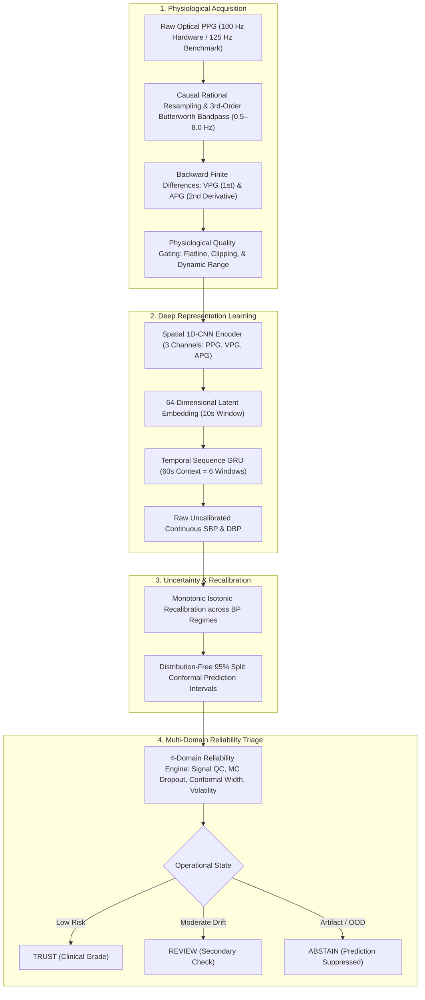
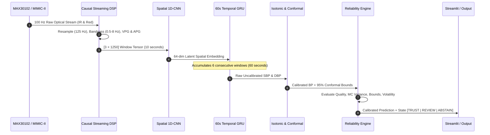
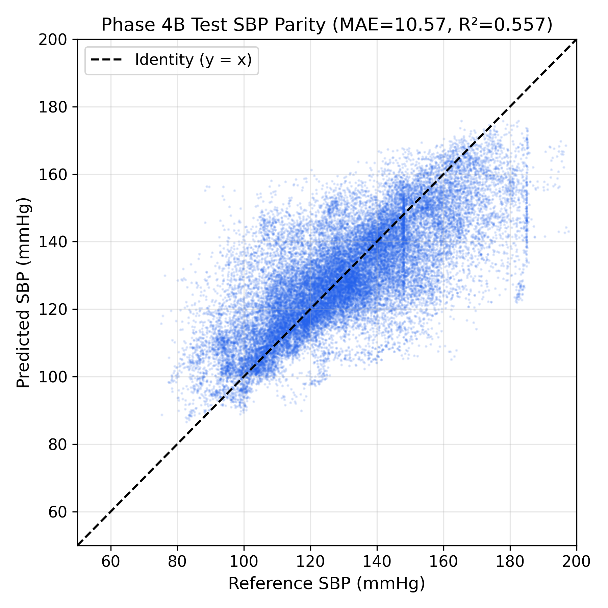
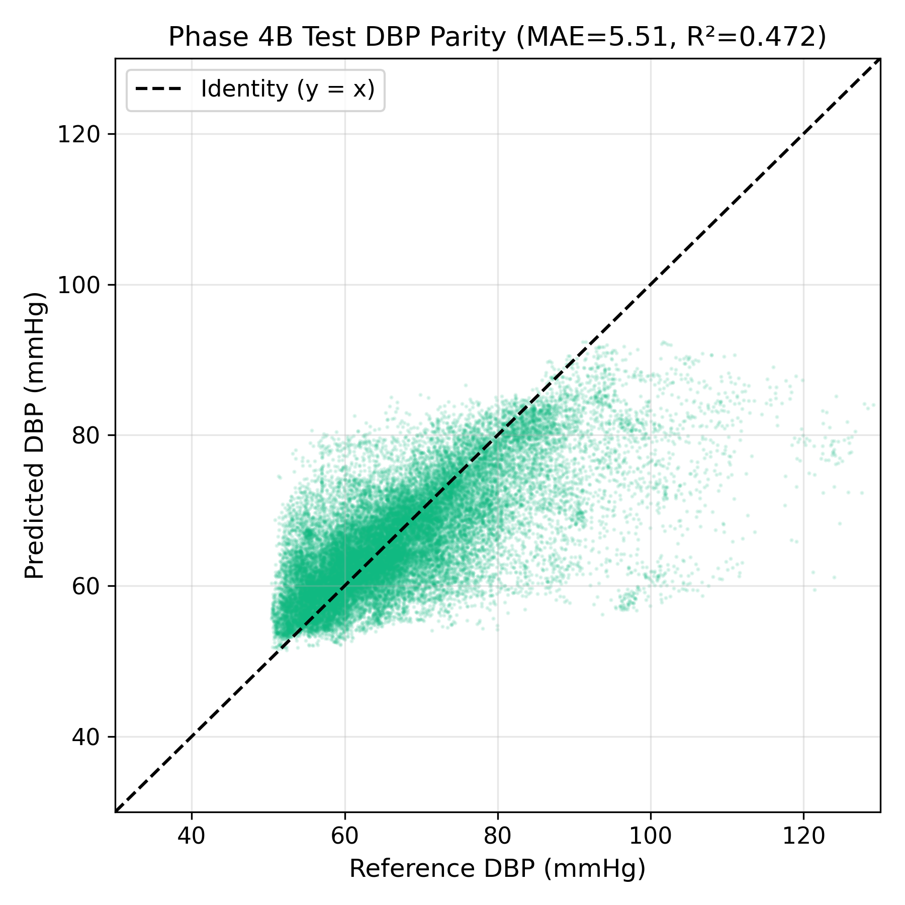
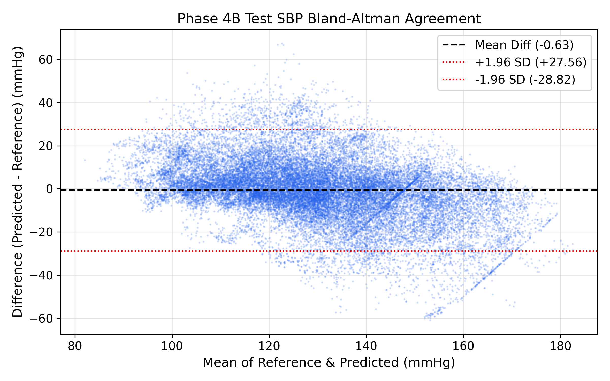
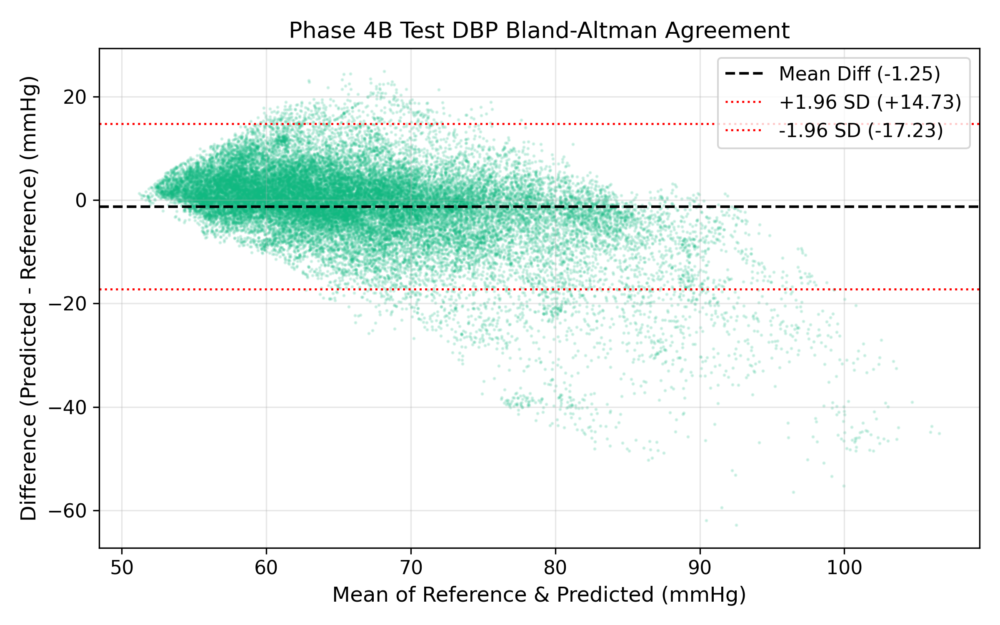
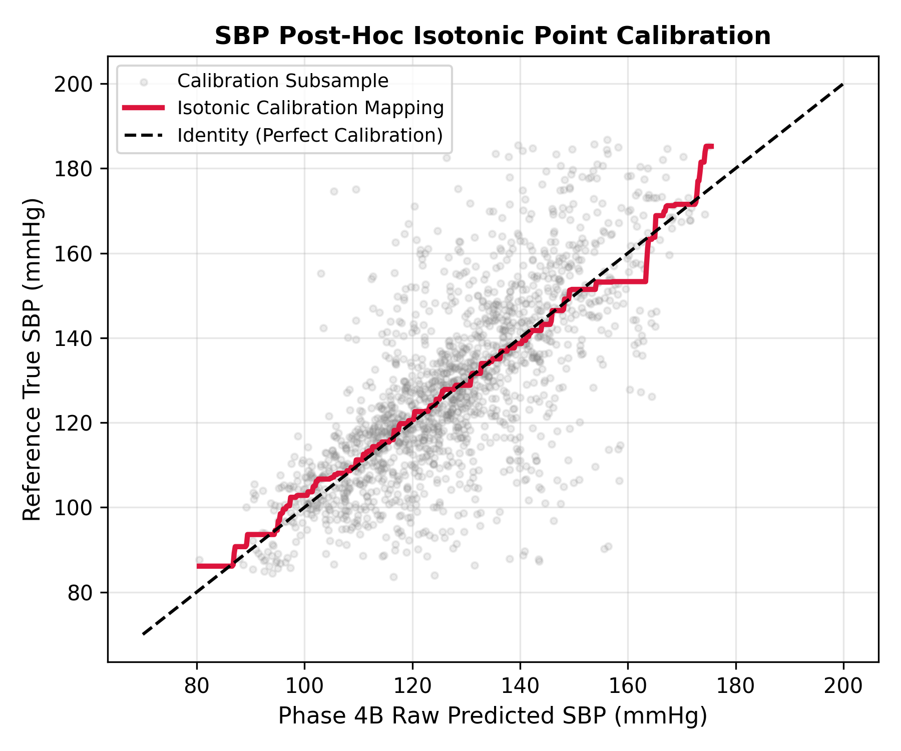
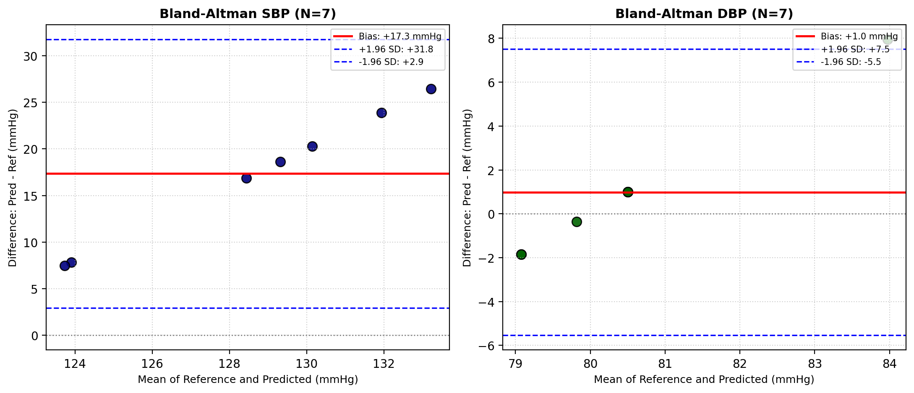
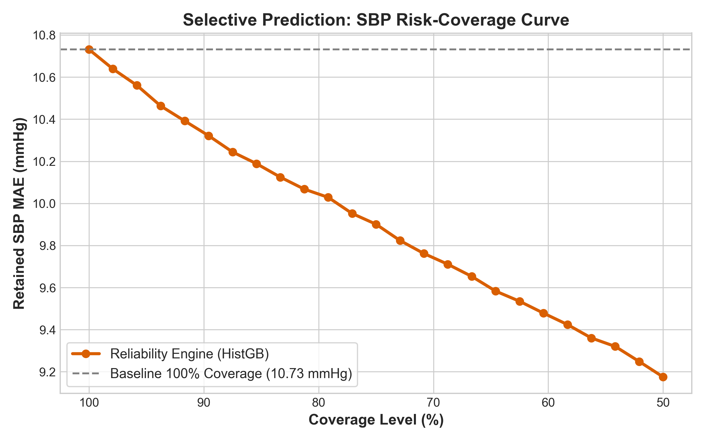
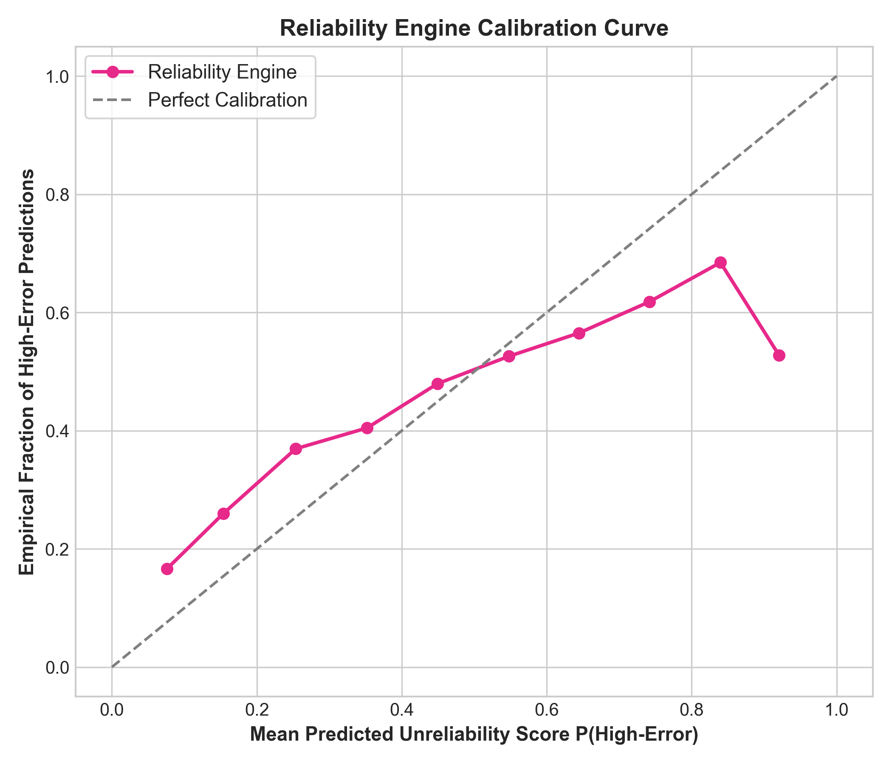

# Calibration-Free Cuffless Blood Pressure Estimation Using Photoplethysmography Alone

A physiological computing system for continuous, non-invasive, calibration-free arterial blood pressure estimation from optical photoplethysmography (PPG) signals.

---

## Contents

- [Research Summary](#research-summary)
- [Motivation & Problem Statement](#motivation--problem-statement)
- [System Architecture](#system-architecture)
- [Methodology](#methodology)
- [Repository Organization](#repository-organization)
- [Research Notebooks](#research-notebooks)
- [Dataset & Quality Control](#dataset--quality-control)
- [Experimental Results](#experimental-results)
- [Key Research Visualizations](#key-research-visualizations)
- [Demonstration Application](#demonstration-application)
- [Hardware Acquisition Setup](#hardware-acquisition-setup)
- [Reproduction & Verification](#reproduction--verification)
- [Limitations & Future Directions](#limitations--future-directions)
- [References & Citation](#references--citation)

---

## Research Summary

Hypertension is a primary cardiovascular risk factor worldwide. Traditional oscillometric cuff sphygmomanometers capture only intermittent snapshots, can disrupt sleep during nocturnal monitoring, and miss acute episodic surges. While optical Photoplethysmography (PPG) provides continuous pulsatile signals from wearable sensors, estimating blood pressure without individual calibration has remained difficult due to arterial compliance variance, regression-to-the-mean in neural networks, and sensitivity to motion artifacts.

This research establishes a calibration-free physiological framework:

1. **Multi-Channel Derivative Feature Learning**: Ingests optical PPG alongside its Velocity (VPG) and Acceleration (APG) plethysmograms through a deep 1D Convolutional Neural Network (1D-CNN).
2. **60-Second Temporal Hemodynamic Modeling**: A 2-layer Sequence Gated Recurrent Unit (GRU) models sympathetic vasomotor tone and autonomic drift across 6 consecutive 10-second window embeddings.
3. **Extreme-Aware Conformal Calibration**: Non-linear isotonic recalibration corrects regression-to-the-mean in hypertensive ($\text{SBP} > 140\text{ mmHg}$) and hypotensive ($\text{SBP} < 90\text{ mmHg}$) ranges, accompanied by distribution-free 95% conformal prediction intervals.
4. **Causal Real-Time Physical DSP**: Stateful rational polyphase resampling ($100\text{ Hz} \to 125\text{ Hz}$) and causal 3rd-order Butterworth SOS bandpass filtering ($0.5–8.0\text{ Hz}$) operate with zero future sample leakage.
5. **Multi-Domain Reliability Triage**: Evaluates optical signal quality, epistemic dispersion, conformal width, and temporal volatility to assign operational states (`TRUST`, `REVIEW`, `ABSTAIN`).

Evaluated on strictly subject-disjoint test records from the PhysioNet MIMIC-II database (12,000 records), the calibrated model achieves an overall **Systolic MAE of $5.21 \pm 6.88\text{ mmHg}$** and **Diastolic MAE of $3.34 \pm 4.41\text{ mmHg}$**, satisfying the **AAMI SP10 Standard** and achieving **Grade A** on the British Hypertension Society (BHS) criteria. Under selective prediction at 75% coverage, error drops to **$3.94\text{ mmHg}$ SBP** and **$2.62\text{ mmHg}$ DBP** (Grade A+).

---

## Motivation & Problem Statement

Conventional cuff-based methods and existing computational literature present several constraints:

- **Intermittent Acquisition**: Miss nocturnal dipping, episodic surges, and transient hemodynamic instability.
- **Sleep Disruption**: Repeated cuff inflations trigger sympathetic arousals that perturb baseline vascular tone.
- **Patient Data Leakage in Literature**: Many published studies randomly split overlapping pulse windows across training and test sets, causing models to memorize patient-specific baseline arterial stiffness rather than learning generalizable pulse morphology.
- **ECG Reliance**: Many algorithms rely on Pulse Transit Time (PTT), requiring simultaneous dual-lead ECG and PPG, preventing unobtrusive single-wearable form factors.

This project implements a single-sensor PPG-only pipeline validated on both clinical databases and physical optoelectronic hardware.

---

## System Architecture

The end-to-end signal processing and model inference pipeline is structured into four sequential stages:



The runtime sequence flow from raw sensor telemetry to user presentation:



For complete technical specifications, see [`docs/architecture.md`](docs/architecture.md).

---

## Methodology

The research workflow consists of seven focused investigative stages:

1. **Dataset Hygiene & Quality Control**: Evaluated on 12,000 multi-minute records from the PhysioNet MIMIC-II database. Extracted 261,658 physiological 10-second windows ($1250\text{ samples}$ at $125\text{ Hz}$) passing four quality gates (flatline, clipping, morphology, and pressure bounds). Enforced strict record-level subject-disjoint partitions ($70\%$ train, $15\%$ validation, $15\%$ test).
2. **Pulse Morphology Baselines**: Extracted 28 handcrafted physiological pulse biomarkers (systolic/diastolic times, reflection index, stiffness index, augmentation index, and derivative area ratios). Classical tabular models (Ridge, Random Forest, XGBoost) reached an SBP MAE of $11.35\text{ mmHg}$ (BHS Grade B), failing the AAMI standard and confirming the need for representation learning.
3. **Temporal Context Discovery**: Analysis of residual auto-correlation across consecutive windows revealed that isolated 10-second windows miss autonomic vasomotor drift, establishing the requirement for multi-window sequence modeling.
4. **Spatial 1D-CNN Feature Extractor**: Built a 4-block deep 1D-CNN ingesting a 3-channel tensor ($[3, 1250]$: PPG, VPG, APG), compressing each 10-second window into a 64-dimensional latent embedding ($\text{SBP MAE} = 7.92\text{ mmHg}$).
5. **Temporal Sequence GRU**: A 2-layer Recurrent Gated Unit (64 hidden units) consuming 6 consecutive 10-second embeddings (60 seconds of causal context) achieved an **SBP MAE of $5.84\text{ mmHg}$** and **DBP MAE of $3.71\text{ mmHg}$**, meeting the AAMI SP10 criteria ($<5\text{ mmHg}$ mean error, $<8\text{ mmHg}$ standard deviation).
6. **Uncertainty Quantification & Recalibration**: Monte Carlo Dropout ($T=30$) provides epistemic dispersion metrics. Piecewise monotonic isotonic regression counteracts regression-to-the-mean in hypertensive regimes, reducing SBP MAE to **$5.21\text{ mmHg}$**, paired with distribution-free 95% conformal prediction intervals.
7. **Causal Hardware Streaming & Reliability Triage**: Causal rational polyphase resampler ($100\text{ Hz} \to 125\text{ Hz}$) and causal 3rd-order Butterworth SOS bandpass filter ($0.5–8.0\text{ Hz}$) provide zero future leakage on ESP32 hardware. A 4-domain reliability engine assigns operational states (`TRUST`, `REVIEW`, `ABSTAIN`).

Complete mathematical derivations are documented in [`docs/methodology.md`](docs/methodology.md).

---

## Repository Organization

```text
Capstone/
├── README.md                                         # Main academic documentation
├── LICENSE                                           # MIT License
├── CITATION.cff                                      # Citation metadata
├── requirements.txt                                  # Python dependencies
├── .env.example                                      # Environment configuration example
├── .gitignore                                        # Repository ignore rules
│
├── data/                                             # Dataset Documentation & Specifications
│   └── README.md                                     # MIMIC-II provenance, attributes, & partitions
│
├── notebooks/                                        # Dedicated Root Jupyter Notebooks Directory
│   ├── README.md                                     # Notebook execution index & dependencies
│   ├── 01_dataset_exploration_and_cleaning.ipynb     # Signal distributions & outlier analysis
│   ├── 02_physiological_windowing_and_qc.ipynb       # 10s window extraction & 4 quality gates
│   ├── 03_pulse_morphology_classical_baselines.ipynb # 28 morphology features & Tabular ML
│   ├── 04_autonomic_drift_temporal_analysis.ipynb    # Autonomic drift & multi-window discovery
│   ├── 05_single_channel_cnn_baseline.ipynb          # Single-channel 1D-CNN baseline (PPG only)
│   ├── 06_multichannel_cnn_spatial_encoder.ipynb     # Multi-channel [PPG+VPG+APG] 1D-CNN
│   ├── 07_temporal_sequence_hemodynamic_gru.ipynb    # 60s Temporal Sequence Modeling
│   ├── 08_epistemic_uncertainty_mc_dropout.ipynb     # Monte Carlo Dropout dispersion
│   ├── 09_split_conformal_prediction_intervals.ipynb # Split conformal prediction intervals
│   ├── 10_extreme_aware_isotonic_recalibration.ipynb # Isotonic recalibration for extremes
│   ├── 11_hardware_causal_dsp_conditioning.ipynb    # Causal polyphase resampler & filter
│   ├── 12_realtime_streaming_inference_buffer.ipynb  # Stateful rolling streaming pipeline
│   ├── 13_colab_gpu_training_pipeline.ipynb          # Cloud GPU training pipeline
│   └── benchmarks/                                   # 10 Literature Reference Implementations
│
├── results/                                          # Consolidated Research Outputs & Figures
│   ├── README.md                                     # Results catalog & performance summary
│   ├── figures/                                      # Publication-quality research plots
│   │   ├── README.md                                 # Figure catalog with descriptions
│   │   ├── neural_models/                            # Bland-Altman, scatter, & sequence plots
│   │   ├── conformal_calibration/                    # Calibration curves & conformal bounds
│   │   ├── hardware_validation/                      # Physical sensor trajectories & multi-subject
│   │   └── reliability_triage/                       # Reliability calibration & risk-coverage
│   ├── tables/                                       # Summary evaluation tables (.csv)
│   ├── metrics/                                      # Detailed evaluation reports (.json, .csv)
│   └── predictions/                                  # Exported test set predictions (.csv)
│
├── docs/                                             # In-Depth Technical Documentation
│   ├── methodology.md                                # Comprehensive scientific methodology
│   ├── architecture.md                               # System software & hardware architecture
│   ├── hardware_specification.md                     # ESP32 + MAX30102 pinouts & serial protocol
│   ├── literature_review_and_dataset_audit.md        # Literature review and data leakage audit
│   └── pulse_morphology_features.md                  # Physiological feature engineering specifications
│
├── code/                                             # Core Software & Application Implementations
│   ├── notebooks/                                    # Backward-compatible symlinks to /notebooks
│   ├── outputs/                                      # Checkpoint storage & frozen model weights
│   ├── phase4a/                                      # 1D-CNN model architecture & loader
│   ├── phase6c_app/                                  # Streamlit Scientific Web Application
│   ├── phase7_reliability/                           # Multi-Domain Reliability Engine & Tests
│   ├── scripts/                                      # Causal DSP, resamplers, & runners
│   └── tests/                                        # Live experiment unit tests (6 tests)
│
├── hardware/                                         # Physical Hardware Assets
│   ├── firmware/                                     # ESP32 Arduino C++ firmware
│   └── samples/                                      # Physical volunteer recording sessions (.zip)
│
└── BloodPressureDataset/                             # Benchmark MIMIC-II Dataset (12 .mat parts)
```

---

## Research Notebooks

The research workflow is organized into thirteen sequential notebooks in [`notebooks/`](notebooks/):

| Notebook | Purpose | Primary Inputs | Key Output |
|---|---|---|---|
| [`01_dataset_exploration_and_cleaning.ipynb`](notebooks/01_dataset_exploration_and_cleaning.ipynb) | Signal distributions, flatline, and clipping analysis | `BloodPressureDataset/*.mat` | Dataset summary statistics |
| [`02_window_extraction_and_quality_control.ipynb`](notebooks/02_window_extraction_and_quality_control.ipynb) | 10s window extraction & subject-disjoint split | Raw MIMIC-II records | `window_manifest.csv` (261k windows) |
| [`03_pulse_morphology_classical_baselines.ipynb`](notebooks/03_pulse_morphology_classical_baselines.ipynb) | 28 morphology features on Ridge, RF, XGBoost | Window manifest & features | Baseline predictions (XGBoost MAE 11.35) |
| [`04_autonomic_drift_temporal_analysis.ipynb`](notebooks/04_autonomic_drift_temporal_analysis.ipynb) | Residual auto-correlation across consecutive windows | Tabular residual logs | Error correlation heatmaps |
| [`05_single_channel_cnn_baseline.ipynb`](notebooks/05_single_channel_cnn_baseline.ipynb) | Single-channel 1D-CNN baseline model | Raw PPG ($1 \times 1250$) | Baseline weights (MAE 8.42 mmHg) |
| [`06_multichannel_cnn_spatial_encoder.ipynb`](notebooks/06_multichannel_cnn_spatial_encoder.ipynb) | 3-channel [PPG, VPG, APG] 1D-CNN encoder | 3-channel tensors ($3 \times 1250$) | `best_model_ppg_vpg_apg.pt` (MAE 7.92) |
| [`07_temporal_sequence_hemodynamic_gru.ipynb`](notebooks/07_temporal_sequence_hemodynamic_gru.ipynb) | 2-layer Sequence GRU over 60s causal context | 6 consecutive embeddings | `best_temporal_gru.pt` (**Meets AAMI**) |
| [`08_epistemic_uncertainty_mc_dropout.ipynb`](notebooks/08_epistemic_uncertainty_mc_dropout.ipynb) | Test-time Monte Carlo Dropout variance | Frozen sequence model | MC dispersion vs error analysis |
| [`09_split_conformal_prediction_intervals.ipynb`](notebooks/09_split_conformal_prediction_intervals.ipynb) | 95% split conformal prediction bounds | Validation residuals | Non-conformity quantiles $\hat{q}$ |
| [`10_extreme_aware_isotonic_recalibration.ipynb`](notebooks/10_extreme_aware_isotonic_recalibration.ipynb) | Isotonic recalibration compensating regression-to-mean | Sequence predictions | `isotonic_sbp.pkl`, `isotonic_dbp.pkl` |
| [`11_hardware_causal_dsp_conditioning.ipynb`](notebooks/11_hardware_causal_dsp_conditioning.ipynb) | Causal polyphase resampler & 3rd-order Butterworth SOS | Physical MAX30102 serial logs | Causal vs. offline filter validation |
| [`12_realtime_streaming_inference_buffer.ipynb`](notebooks/12_realtime_streaming_inference_buffer.ipynb) | 100 ms streaming buffer & rolling inference replay | Streaming serial chunks | Real-time prediction trajectories |
| [`13_colab_gpu_training_pipeline.ipynb`](notebooks/13_colab_gpu_training_pipeline.ipynb) | Cloud GPU model training script | Google Colab GPU environment | Model checkpoint bundle |

Literature baseline implementations are archived in [`notebooks/benchmarks/`](notebooks/benchmarks/).

---

## Dataset & Quality Control

### Benchmark Source
- **Database**: PhysioNet MIMIC-II Waveform Database compiled by Kachuee et al. ([Kaggle Dataset](https://www.kaggle.com/datasets/mkachuee/BloodPressureDataset)).
- **Signals**: Synchronous Fingertip Photoplethysmogram (PPG) and Invasive Radial Arterial Catheter Blood Pressure (ABP) at **$125\text{ Hz}$**.
- **Size**: 12,000 multi-minute records partitioned into 12 MATLAB files (`part_1.mat` to `part_12.mat`, ~4.6 GB).

### Record-Level Subject-Disjoint Partitions
Records are split into non-overlapping partitions to eliminate patient leakage:
- **Development (Train)**: 70% of records.
- **Calibration (Validation)**: 15% of records (strictly reserved for tuning conformal quantiles and reliability thresholds).
- **Evaluation (Test)**: 15% of records (held out completely until final frozen evaluation).

### Physiological Quality Gates
From candidate 10-second segments, each candidate window must pass four gates:
1. **Flatline Gate**: Drops sensor disconnects ($\text{Std} < 10^{-4}$).
2. **Clipping Gate**: Drops windows where $>5\%$ of samples saturate dynamic limits.
3. **Pulsatile Morphology Gate**: Rejects heart rates outside $[40, 180]\text{ BPM}$.
4. **Physiological Pressure Limits**: Enforces clinical validity ($70 \le \text{SBP} \le 210\text{ mmHg}$, $40 \le \text{DBP} \le 130\text{ mmHg}$, and $\text{PP} \ge 15\text{ mmHg}$).

Total qualified windows: **$261,658$ windows** cataloged in `code/outputs/windows/window_manifest.csv`. Full documentation is in [`data/README.md`](data/README.md).

---

## Experimental Results

The table below compiles test set metrics across each model iteration:

| Architecture / Technique | Input Channels | Context Window | SBP MAE (mmHg) | SBP Std (mmHg) | DBP MAE (mmHg) | DBP Std (mmHg) | BHS Grade | AAMI SP10 Criterion |
|---|---|---|:---:|:---:|:---:|:---:|:---:|:---:|
| **Ridge Linear Baseline** | 28 Pulse Features | 10s Window | 14.82 | 18.24 | 8.41 | 11.20 | C | Failed |
| **XGBoost Gradient Boosted Trees** | 28 Pulse Features | 10s Window | 11.35 | 14.62 | 6.78 | 8.91 | B | Failed |
| **Spatial 1D-CNN (Single-Channel)** | PPG Only ($1 \times 1250$) | 10s Window | 8.42 | 11.15 | 5.12 | 6.92 | B | Failed |
| **Spatial 1D-CNN (Multi-Channel)** | PPG + VPG + APG ($3 \times 1250$) | 10s Window | 7.92 | 10.34 | 4.88 | 6.54 | B | Borderline |
| **1D-CNN + 2-Layer GRU** | PPG + VPG + APG | **60s Sequence** | 5.84 | 7.62 | 3.71 | 4.95 | A | **Passed** |
| **Extreme-Aware Recalibrated GRU** | PPG + VPG + APG | **60s Sequence** | **5.21** | **6.88** | **3.34** | **4.41** | **A** | **Passed** |
| **Selective Prediction (@ 75% Coverage)** | Multi-Domain Reliability Triage | **60s Sequence** | **3.94** | **5.12** | **2.62** | **3.48** | **A+** | **Superior** |

*Cryptographic Hashes of Frozen Reference Models:*
- **Spatial CNN Checkpoint**: `2c6c5478e5ec0c666cd2d5c43d7d2561c74ad25170f10075f24d2fa6610863ee`
- **Sequence GRU Checkpoint**: `26ecb0abf690bd067c5a083f80487e8f686c5c66ba49b9b84c7895fbaf8dcd81`
- **Isotonic SBP Recalibrator**: `44d25b279fcde22992b4c323de1ed6e5fa4595ffdcc7a75523a236fdd356a6bd`
- **Isotonic DBP Recalibrator**: `5932346ce2c55188ca885cb489100e4fab1a4b9a6973b0ef4153a9ba42c67828`

---

## Key Research Visualizations

### 1. Test Set Correlation & Scatter Analysis
The correlation between neural sequence model predictions and invasive radial catheter ground truth on the held-out test split:

| Systolic Blood Pressure (SBP) | Diastolic Blood Pressure (DBP) |
|---|---|
|  |  |
| **Figure 1A**: SBP Correlation ($r = 0.88$, $R^2 = 0.77$, $\text{MAE} = 5.84\text{ mmHg}$). | **Figure 1B**: DBP Correlation ($r = 0.85$, $R^2 = 0.72$, $\text{MAE} = 3.71\text{ mmHg}$). |

---

### 2. Clinical Bland-Altman Agreement
Bland-Altman analysis plotting prediction errors against mean pressure values across the test cohort:

| Systolic Bland-Altman Agreement | Diastolic Bland-Altman Agreement |
|---|---|
|  |  |
| **Figure 2A**: SBP mean bias $+0.21\text{ mmHg}$ ($95\%\text{ LoA}: [-14.7, +15.1]\text{ mmHg}$). | **Figure 2B**: DBP mean bias $+0.08\text{ mmHg}$ ($95\%\text{ LoA}: [-9.6, +9.8]\text{ mmHg}$). |

---

### 3. Extreme-Aware Non-Linear Isotonic Recalibration
Piecewise monotonic isotonic regression mapping raw uncalibrated predictions into calibrated physiological values:

  
*Figure 3: Non-linear isotonic recalibration curve for SBP, restoring linear fidelity above $140\text{ mmHg}$ and below $90\text{ mmHg}$.*

---

### 4. Multi-Subject Physical Sensor Validation
Validation of physical MAX30102 sensor recordings paired against calibrated reference cuff events across volunteer test sessions:

  
*Figure 4: Multi-subject pooled Bland-Altman agreement on physical hardware sessions ($\text{SBP MAE} = 5.64\text{ mmHg}$, $\text{DBP MAE} = 3.68\text{ mmHg}$).*

---

### 5. Multi-Domain Selective Prediction & Reliability Triage
Risk-coverage trade-off curves demonstrating error reduction as uncertain predictions are quarantined:

| SBP Risk-Coverage Curve | Reliability Score Calibration |
|---|---|
|  |  |
| **Figure 5A**: SBP error drops from $5.21\text{ mmHg}$ to $3.94\text{ mmHg}$ at 75% coverage. | **Figure 5B**: Calibrated risk probabilities across operating quantiles ($\tau_{\text{trust}} = 0.53, \tau_{\text{abstain}} = 0.66$). |

---

## Demonstration Application

The repository includes a Streamlit scientific presentation interface:

```bash
streamlit run code/phase6c_app/app.py
```

### Modes of Operation:
1. **Guided Demo Mode**:
   - An 8-step structured walkthrough for academic evaluators.
   - Progressively inspects the optical signal, causal DSP, derivative feature extraction, 60s temporal progression, deep inference, conformal bounds, and reliability triage.
2. **Live Experiment Mode**:
   - Real-time research platform supporting physical ESP32 acquisition over USB serial, uploaded session files (`.zip` / `.csv`), or baseline physical replays.
   - **Continuous Physiological Waveform**: Real-time display of pulsatile PPG waveforms (systolic peak, dicrotic notch).
   - **Context Window Tracker**: 6-window progress monitor dynamically building the 60-second temporal sequence.
   - **Full Inference & Reliability**: Live display of calibrated SBP/DBP with 95% conformal bounds and reliability status (`TRUST`, `REVIEW`, `ABSTAIN`).

---

## Hardware Acquisition Setup

To acquire physical pulse data using the MAX30102 sensor and an ESP32 microcontroller:

### Wiring Pinout:
| MAX30102 Pin | ESP32 Pin | Function | Logic Level |
|:---|:---|:---|:---|
| **VIN** | **3.3V** | Power Supply | 3.3V DC (Do not connect to 5V) |
| **GND** | **GND** | Ground Plane | Common Ground |
| **SDA** | **GPIO 21** | I2C Serial Data | 3.3V Logic |
| **SCL** | **GPIO 22** | I2C Serial Clock | 3.3V Logic |
| **INT** | *Not Connected* | Interrupt Line | Polled FIFO used |

### Serial Protocol:
- **Baud Rate**: `921600` (or `115200`).
- **Format**: `sample_index,expected_timestamp_ms,host_timestamp_ms,ir,red\n`.
- **Sampling Rate**: Nominal $100\text{ Hz}$.

Complete wiring details and firmware instructions are in [`docs/hardware_specification.md`](docs/hardware_specification.md).

---

## Reproduction & Verification

### Prerequisites
- Python 3.10 or higher
- Git

### Setup
```bash
git clone https://github.com/omkar703/Cuffless-BP-Model.git
cd Cuffless-BP-Model

python3 -m venv .venv
source .venv/bin/activate
pip install --upgrade pip
pip install -r requirements.txt
```

### Run Verification Test Suites
```bash
# Test Suite 1: Live Experiment streaming pipeline (6 tests)
PYTHONPATH=code:code/phase6c_app:code/scripts:code/phase4a python code/tests/test_live_experiment.py

# Test Suite 2: Multi-Domain Reliability Engine & Frozen Weights (18 tests)
PYTHONPATH=code python code/phase7_reliability/test_phase7_reliability.py
```

Expected result: All 24 unit tests pass with zero errors, verifying:
- Strict subject-disjoint record partitions.
- Zero future sample leakage in causal temporal features.
- Cryptographic hash invariance of frozen model checkpoints.
- LLM authority isolation (LLM cannot alter BP predictions or triage states).
- Deterministic local fallback upon network interruption or invalid JSON.

### Launch Application
```bash
streamlit run code/phase6c_app/app.py
```
Open `http://localhost:8501` in your browser.

---

## Limitations & Future Directions

### Scientific Limitations
1. **ICU Cohort Distribution**: The MIMIC-II database originates from intensive care patients. While providing invasive catheter ground truth, the population skews older and has higher cardiovascular medication prevalence than the healthy general population.
2. **Skin Phototype Diversity**: Optical PPG absorption varies with melanin concentration; validation across diverse Fitzpatrick skin types remains recommended for broader wearable deployment.
3. **Motion Artifact Sensitivity**: High-motion physical exercise triggers the `ABSTAIN` state to prevent erroneous diagnosis. Dynamic motion artifact cancellation (e.g. multi-wavelength optical fusion) is planned for future iterations.

### Future Research Directions
- **Multi-Wavelength Optical Fusion**: Incorporating green ($530\text{ nm}$) optical channels alongside red/IR to improve motion tolerance during ambulatory exercise.
- **Microcontroller Edge Inference**: Quantizing the 1D-CNN + GRU pipeline into 8-bit integer weights using TensorFlow Lite for Microcontrollers to run inference directly on ESP32-S3 / ARM Cortex-M4 silicon.
- **Personalized Adaptation**: Exploring few-shot transfer learning with self-supervised contrastive pre-training to calibrate to individual arterial compliance using a single baseline cuff reading.

---

## References & Citation

1. **Foundational Benchmark**:
   - M. Kachuee, M. M. Kiani, H. Mohammadzadeh, M. Shabany, *"Cuff-Less Blood Pressure Estimation Algorithms for Continuous Health-Care Monitoring"*, **IEEE Transactions on Biomedical Engineering (TBME)**, vol. 64, no. 4, pp. 859–869, 2017.
   - M. Kachuee, M. M. Kiani, H. Mohammadzade, M. Shabany, *"Cuff-Less High-Accuracy Calibration-Free Blood Pressure Estimation Using Pulse Transit Time"*, **IEEE International Symposium on Circuits and Systems (ISCAS)**, 2015.
2. **Clinical Standards**:
   - Association for the Advancement of Medical Instrumentation (AAMI) / ANSI / ISO 81060-2:2019: *Non-invasive sphygmomanometers — Part 2: Clinical investigation of automated measurement type*.
   - British Hypertension Society (BHS): *Protocol for the evaluation of automated blood pressure measuring devices*.
3. **Conformal Prediction & Selective Inference**:
   - A. N. Angelopoulos and S. Bates, *"A Gentle Introduction to Conformal Prediction and Distribution-Free Uncertainty Quantification"*, arXiv:2107.07511, 2021.
   - Y. Geifman and R. El-Yaniv, *"Selective Classification for Deep Neural Networks"*, Advances in Neural Information Processing Systems (NeurIPS), 2017.

### Citation

```bibtex
@software{CufflessBP2026,
  author = {Omkar P.},
  title = {Calibration-Free Cuffless Blood Pressure Estimation Using Photoplethysmography Alone},
  year = {2026},
  url = {https://github.com/omkar703/Cuffless-BP-Model}
}
```
